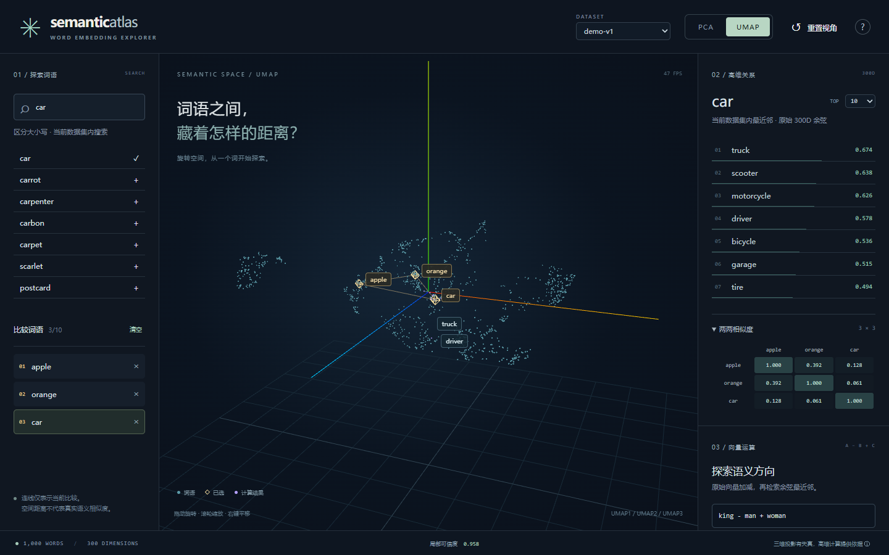
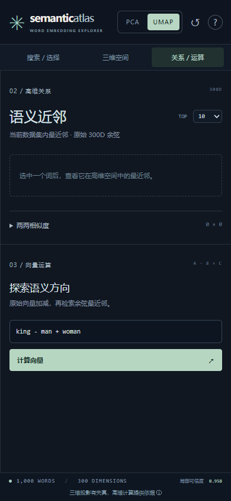

# 开发验收记录

日期：2026-10-25（Asia/Shanghai）。环境：Windows x64、Python 3.13.9、Node.js 24.19.0、pnpm 11.25.0。Python 完整依赖见 `backend/requirements.lock`，前端见 `frontend/pnpm-lock.yaml`。

## 数据与数学

- 成功下载 Google News 预训练模型，源文件 SHA-256：`cdd97c3b73abcd8e1437ad3837b8faf98fc21258f61f031721fe3e2096ed89d9`。
- `demo-v1` 为真实 1,000×300 词向量数据，修订词表后 OOV 为 0；不是随机点云。单次完整 CLI 构建约 39.74 秒（不含下载）；流式提取、降维过程的峰值工作集为 449,757,184 字节，约 429 MiB。首个构建报告中的 total_seconds 仅统计准备与投影阶段，不包含首次导入降维依赖的约 7 秒；构建脚本已修正此计时遗漏，既有产物不改写。
- 同环境独立复建后，原始向量一致；还原显示变换后的 PCA、UMAP 坐标最大差异均为 0，trustworthiness 差异均为 0。此结果不意味着跨版本、跨平台逐位一致。
- PCA 前三主成分方差保留累计 0.112242；trustworthiness（k=10，高维 cosine/三维 Euclidean）PCA=0.792389、UMAP=0.958422。
- `cos(apple,orange)=0.392035`，`cos(apple,car)=0.128307`，`cos(orange,car)=0.061496`。
- apple 在当前集合内前三近邻为 pear=0.645070、fruit=0.641015、strawberry=0.605826。
- `king - man + woman` 当前集合内第一名 queen=0.730052，第二名 ruler=0.524742。结果由原始向量计算，不作为固定答案写入代码。

复验命令：`python backend/scripts/verify_dataset.py backend/data/demo-v1`。独立构建到另一父目录下同名数据集后，增加 `--compare <另一目录>/demo-v1` 检查坐标容差及诊断差异。

## 功能与测试

- 后端 34 项测试通过：数学、API、输入边界、哈希/元数据损坏、流式二进制读取、近零阈值、真实降维复建和不可覆盖。
- 前端 9 项单元测试通过：表达式合法/非法输入、大小写与重复项、多选上限、投影状态保留、过期类比响应丢弃。
- TypeScript 类型检查与 Vite 生产构建通过，Three.js 被分为独立 chunk；无外部字体或图片加载依赖。
- Edge（Chromium 引擎）4 项 Playwright 端到端测试通过：桌面搜索 apple/orange/car、多选与矩阵、投影切换、拖动防误选、向量运算、近零错误、清空；无 WebGL 时数学面板仍可用；网络失败重试恢复；390×844 移动端分栏与无水平溢出。核心桌面/移动端测试在合成数据与真实数据上各执行成功，完整 4 项回归使用真实数据。
- 内置浏览器观察到点云、拾取高亮和多选；静态观察约 60 FPS。自动化截图时软件渲染环境约 43 FPS。这是本机观察，未进行跨设备压力基准。
- 下载的独立 Chromium 在本机启动报 spawn UNKNOWN；改用已安装的 Edge 成功验证，没有把失败的 Chromium 启动算作测试通过。可用 `$env:PLAYWRIGHT_CHANNEL='msedge'; pnpm test:e2e` 复现本次浏览器测试。
- 一键启动 `python scripts/dev.py` 已实测：前端 HTTP 200，health=ok，注册 demo-v1 与 synthetic-demo；Ctrl+C 后后端完成关闭，临时预览服务已停止。

桌面截图：

移动端截图：

## 交付范围

源码、数据构建/下载/复验脚本、1,000 词词表、锁文件、测试、开发启动脚本、API/架构/数据与限制文档已提供。真实数据集和完整源模型仅保存在本机忽略目录。未执行公开部署；权重分发许可仍未确认。后端测试依赖会输出 Starlette 关于 httpx 的弃用提醒，当前测试正常通过。
